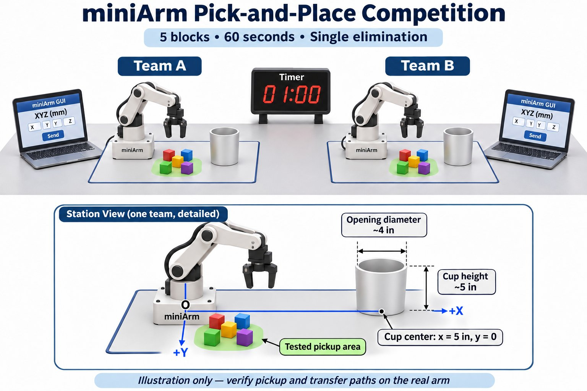

# miniArm Pick-and-Place Competition

**Five blocks. Two teams. Sixty seconds. Single elimination.**

Use visual coordinate estimation, your calibrated miniArm, and the Lab 03 GUI to pick up five blocks one at a time and drop them into a cup. The winner advances; the losing team is eliminated.

*Illustrative setup, not a scale drawing or a certified workspace map. Every block and the complete route to the cup must be tested on the actual arm.*

## 1. Match format

- Two teams compete simultaneously at separate, equivalent stations.
- Before each match, the instructor randomly places **five identical lightweight blocks per team** inside the approved pickup area in front of each arm. Use matching relative layouts at both stations so difficulty is comparable.
- Teams locate blocks **by eye** and enter estimated grasp coordinates into the GUI. A fixed coordinate grid on the work surface is allowed equally at both stations; rulers, touching/repositioning blocks, camera detection and automatic localization are not used during the match.
- The common **60-second timer starts at “Go,” before teams estimate or enter the new block coordinates**. Robot setup and calibration happen beforehand. Keep the new layout concealed until Go, or prevent teams from inspecting/entering coordinates before Go.
- The GUI controls pickup and transfer, **one block per cycle**. Teams may choose block order and retry missed blocks within the time limit.
- The first team to score all five blocks wins immediately. Otherwise, the team with more scored blocks at 60 seconds wins.

## 2. Station and cup geometry

Each station needs one secured miniArm, a computer with the [Lab 03 control GUI](../lab03_inverse_kinematics/miniarm_controlC/README.md), five blocks, one secured cup and a marked pickup area. Keep the two robot workspaces separate.

Use world frame {0}: **origin at the base rotation axis projected onto the supporting floor plane; +X right, +Y forward, +Z up**. “Floor” means the shared flat surface supporting the robot and cup; if the setup is on a table, that tabletop is Z=0. Do not measure from the front edge of the robot housing. Each station has its own local origin.

| Cup property | Inches | GUI value (mm) |
| --- | ---: | ---: |
| Center X | 5 | 127 |
| Center Y | 0 | 0 |
| Bottom Z | 0 | 0 |
| Approximate height / rim Z | 5 | 127 |
| Approximate opening diameter | 4 | 101.6 |

The cup stands to the arm's **right**, on the floor plane, with its opening facing upward. Measure the actual cup and use those dimensions in **Cup settings...**. At a nominal 4-inch diameter, the opening extends approximately from X=3 to X=7 inches and Y=-2 to Y=2 inches; keep blocks outside the physical cup footprint and leave clearance for the moving arm.

**The cup bottom is not the release target.** Release the held block above the rim with clearance for the block and claw. The existing planner determines this from the cup, held-block radius and margin settings. Its illustrative defaults give release XYZ = [127, 0, 172] mm; use measured settings, not that value blindly. See the [block-to-cup guide](../lab03_inverse_kinematics/PICK_PLACE.md).

## 3. Keep every block within usable reach

The instructor marks a **tested pickup area in front of the arm (+Y)** before the event. There is no universal reach radius: usable reach depends on joint limits, calibration, grasp height, claw orientation and the cup transfer route.

Before approving the area:

1. Secure the robot and cup at the specified coordinates. Use the same block dimensions, orientation convention, surface height and cup settings at both stations.
2. Test representative points throughout the area, including its boundaries, using the complete pick-and-place planner. Exclude locations too close to the base, beyond reach, obstructed by the cup, or unsuitable for the claw's grasp orientation.
3. Perform physical pickup-to-cup trials with the actual blocks. A successful IK solution alone is insufficient: approach, lift, transfer, release and retreat must also work.
4. Randomly select placements only from this approved area (a set of previously tested grid locations is a practical option). Keep blocks separated so the claw can grasp one without disturbing another. Do not stack blocks.
5. Run a timed five-block rehearsal using the class GUI and agreed motion settings. Five blocks in 60 seconds is a target, not a demonstrated capability; confirm feasibility before the tournament. Scoring by block count still allows a winner if neither team finishes.

Keep the tested area modest; the illustration's green patch is conceptual and does not define numerical workspace limits.

## 4. Team preparation — before the clock

- Complete [Lab 03](../lab03_inverse_kinematics/STUDENT_GUIDE.md), using your arm's measured calibration and correct TCP definition.
- Connect the GUI and enable/initialize the servos according to its guide. Begin each match at the same instructor-approved ready pose, with an empty, open claw.
- Verify cup dimensions, claw Open/Closed presets, block/grasp size and clearance settings. Test these with practice blocks before the match layout is placed.
- Use the instructor-approved firmware, motion duration and grip/settling settings consistently across stations. Do not disable planner checks to save time.
- Assign a GUI operator and, if desired, a teammate to estimate/read coordinates. Keep all hands clear while the arm moves.

## 5. During the match — current GUI workflow

**The current GUI accepts one pickup target at a time; it does not provide a five-block queue or automatically detect block positions.** Repeat the following workflow for each block:

1. After Go, estimate the chosen block's **TCP grasp point** relative to the base origin. Enter X, Y and Z in **millimeters** in IK CONTROL. The grasp point is where the claw should close, not the block's bottom corner or automatically Z=0. Use the practiced grasp height for these identical blocks.
2. Confirm cup settings remain correct. Click **Preview Pick & Place** to plan and check the complete cycle without moving the robot.
3. If the plan passes, click **Run Pick & Place**. The GUI opens the claw, approaches, grasps, lifts, transfers, releases above the cup and retreats.
4. Watch the actual result. Software completion does not verify a successful grasp or score. Once the cycle finishes, enter the next target and repeat. For a miss, estimate again and retry if time permits.
5. At the stop signal, stop issuing commands and use **STOP** to cancel remaining motion steps. The referee counts the score at the deadline. The GUI does not enforce the competition timer.

A new pickup requires a fresh valid plan. Fixed cup settings can remain unchanged, but students should use the existing preflight workflow rather than bypassing checks or assuming every intermediate pose is feasible. This competition folder adds rules and an illustration; it does not change GUI or firmware behavior.

## 6. Scoring and refereeing

| Situation | Decision |
| --- | --- |
| A block has fully entered the cup and remains inside | 1 point, maximum 5 |
| Fifth block enters and remains inside before the deadline | Team wins; record finish time |
| Neither team scores all five | Higher score at 60 seconds wins |
| Block held by claw, on rim, outside cup, or entering after deadline | No point |
| Dropped block still inside approved area | May retry using GUI within remaining time |
| Block leaves approved area or cup tips | No hands-on recovery during that attempt; referee determines score |
| Equal scores at 60 seconds, including 0–0, or indistinguishable finish times | Tie-break below |

**Tie-break:** Reset both stations and run another 60-second match with **one block per team at the same instructor-selected, tested relative location**. First successful score wins. If neither scores, reset and repeat at another approved location. The referee resolves indistinguishable scores with another tie-break.

Do not touch the robot, cup or blocks during an active attempt. If intervention is needed, call the referee and stop. A fault attributable to the organizer's station/setup causes a restart for both teams with a new matched layout; an ordinary missed grasp or coordinate-entry error remains part of play. The referee decides fault attribution.

STOP cancels the remaining task and may retain the grip/servo holding power; it is **not a guaranteed instantaneous physical emergency stop**. Follow the lab's supervised power-isolation procedure if necessary. Safety intervention takes priority over the timer.

## 7. Single-elimination bracket

The instructor randomly draws team positions and posts the bracket before the first round. Each match produces one advancing team. For a team count that is not a power of two, assign randomly drawn first-round byes to fill the next power-of-two bracket. A bye advances a team without a match.

For eight teams: four quarterfinals → two semifinals → one final. The final winner is champion. Re-randomize the matched block layout for each match.

| Match | Team A | Team B | A score / finish time | B score / finish time | Winner |
| --- | --- | --- | --- | --- | --- |
| ____ | ____ | ____ | ____ | ____ | ____ |

## Instructor launch checklist

- [ ] Cup center [127, 0] mm and actual height/opening checked at both stations.
- [ ] Five identical blocks per station; full pickup-to-cup route physically tested throughout marked area.
- [ ] Matched random layouts and common ready pose prepared.
- [ ] Calibration, firmware, allowed settings and GUI workflow checked.
- [ ] Timed rehearsal completed; 60-second timer, referee and stop procedure ready.
- [ ] Students briefed on timer start, scoring, tie-break and no-touch rule.
- [ ] Bracket and first-round byes posted.
